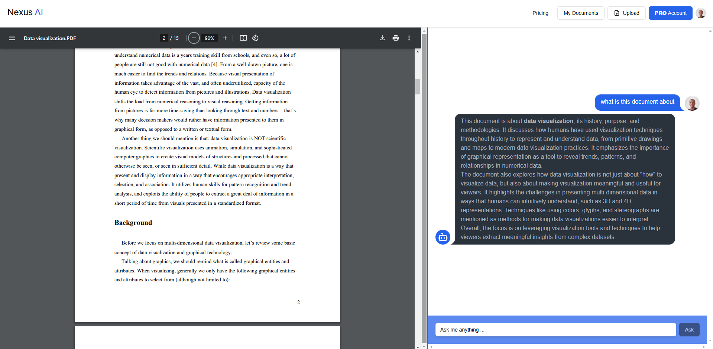
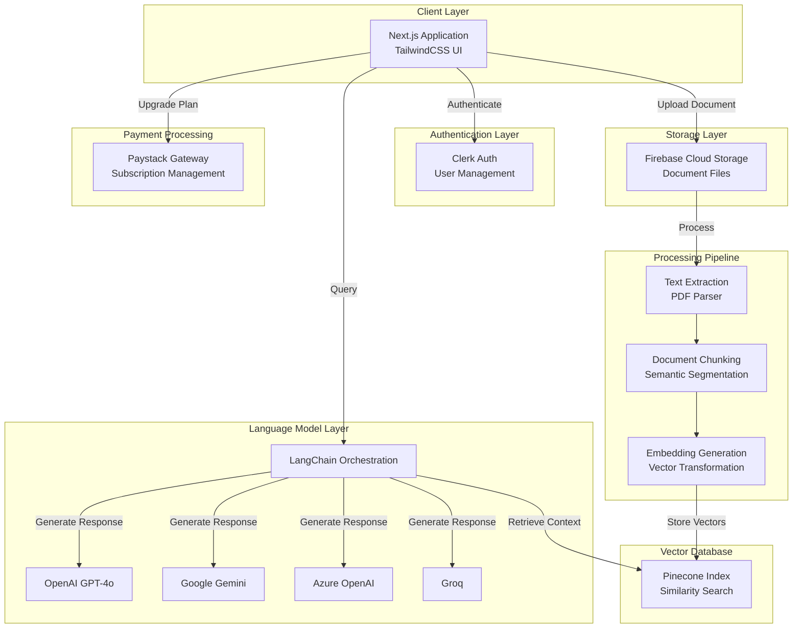
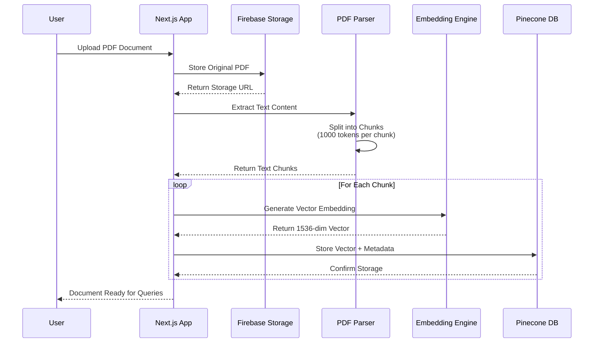
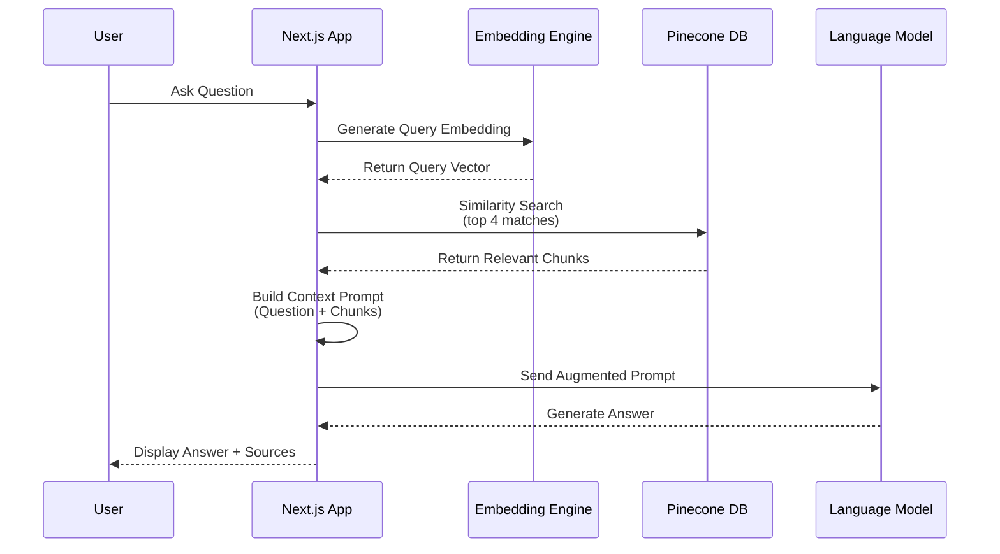
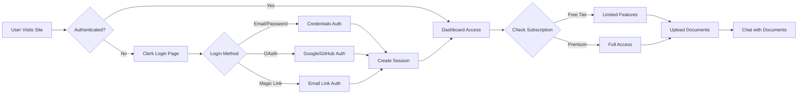
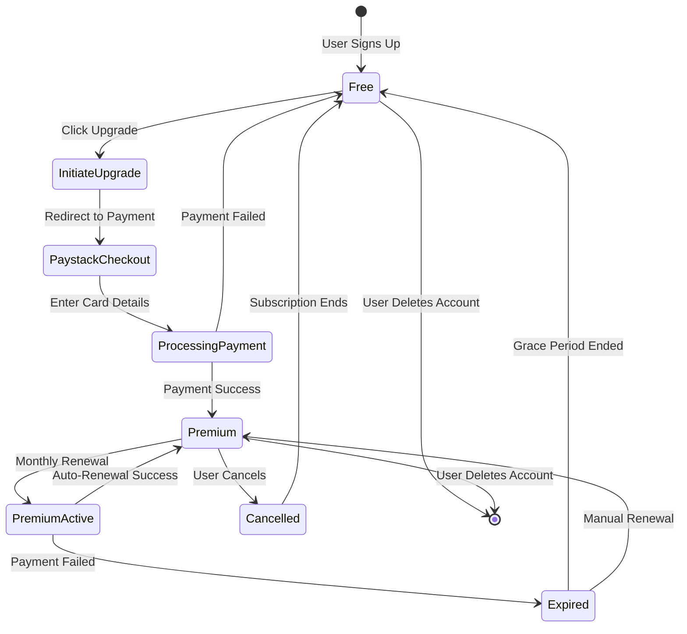
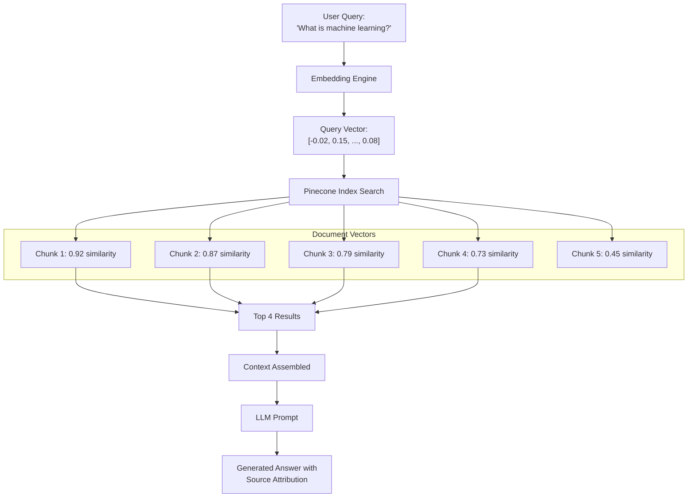
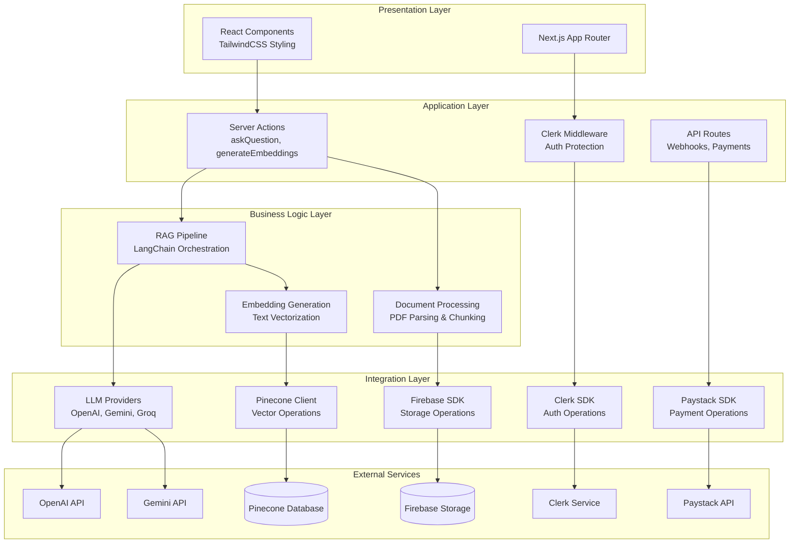
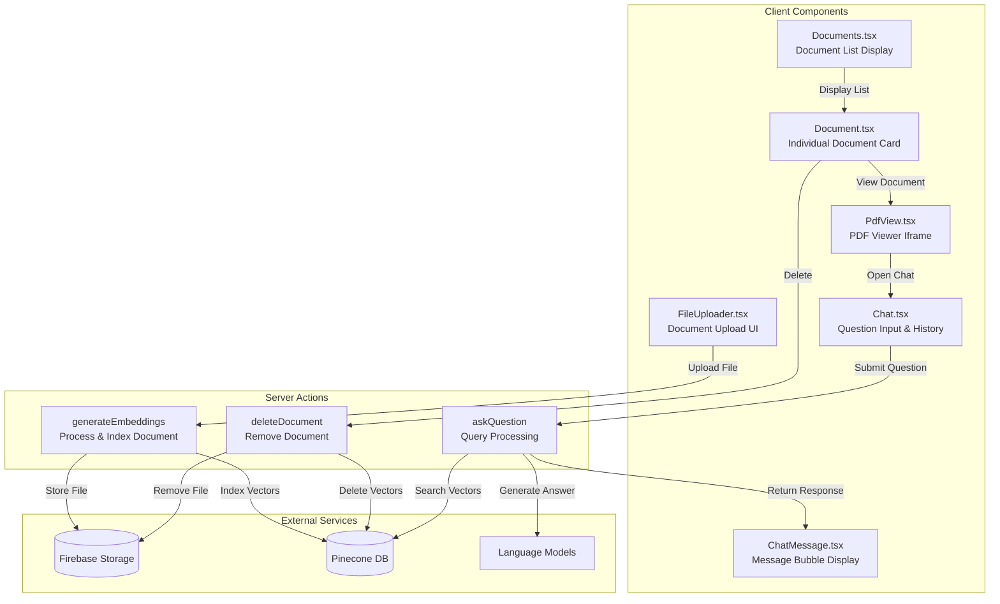
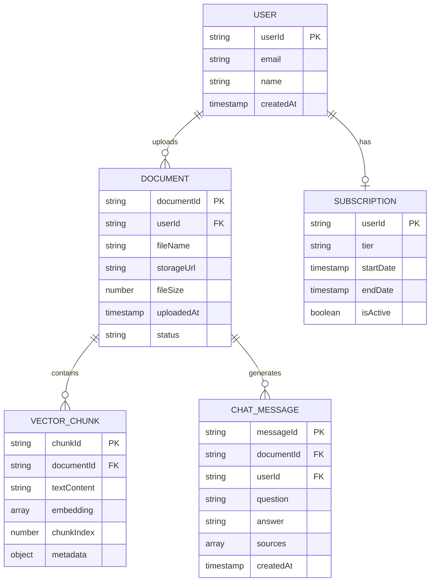

# Nexus AI

> An intelligent document management platform that enables users to upload, store, and interact with their documents through natural language conversation.

<p align="center">
  <a href="https://www.producthunt.com/posts/nexus-ai-3" target="_blank">
    
  </a>
</p>

<p align="center">
  <a href="https://github.com/preston176/nexusAI" target="_blank">
    
  </a>
  <a href="https://github.com/preston176/nexusAI/issues" target="_blank">
    
  </a>
  <a href="https://github.com/preston176/nexusAI" target="_blank">
    
  </a>
</p>

---

## Table of Contents

- [Overview](#overview)
- [Demo](#demo)
- [Key Features](#key-features)
- [Architecture](#architecture)
- [Technology Stack](#technology-stack)
- [Getting Started](#getting-started)
  - [Prerequisites](#prerequisites)
  - [Installation](#installation)
  - [Configuration](#configuration)
- [Deployment](#deployment)
- [Project Structure](#project-structure)
- [API Documentation](#api-documentation)
- [Contributing](#contributing)
- [License](#license)
- [Contact](#contact)

---

## Overview

Nexus AI is a production-ready web application that transforms how users interact with their document collections. By combining document storage with retrieval-augmented generation (RAG), the platform allows users to query their documents using natural language and receive contextually accurate responses.

The system processes uploaded documents by extracting text content, generating vector embeddings, and storing them in a high-performance vector database. When users ask questions, the platform retrieves relevant document segments and uses large language models to generate precise, source-grounded answers.

### Use Cases

- **Research & Analysis**: Query academic papers, research documents, and technical reports
- **Compliance & Legal**: Search through contracts, policies, and regulatory documents
- **Knowledge Management**: Build searchable repositories of organizational documentation
- **Education**: Interactive learning with textbooks and course materials
- **Personal Archive**: Organize and query personal document collections

---

## Demo

<p align="center">
  <a href="https://nexusai-pdf.vercel.app" target="_blank">
    
  </a>
</p>

<div align="center">
  <a href="https://nexusai-pdf.vercel.app" target="_blank"><strong>Live Application</strong></a> |
  <a href="https://youtu.be/ABdXAWunyuc" target="_blank"><strong>Video Walkthrough</strong></a>
</div>

---

## Key Features

### Document Management

- **Multi-format Support**: Upload and process PDF documents with automatic text extraction
- **Cloud Storage**: Secure document storage using Firebase Cloud Storage with user isolation
- **Document Organization**: Track upload history, metadata, and processing status

### Intelligent Querying

- **Semantic Search**: Vector-based similarity search using Pinecone for relevant context retrieval
- **Contextual Responses**: Generate answers grounded in actual document content
- **Multi-provider Support**: Choose from OpenAI GPT-4o, Google Gemini, Azure OpenAI, or Groq
- **Conversation History**: Maintain context across multiple queries within a session

### Authentication & Security

- **Enterprise Authentication**: Clerk integration with email, OAuth, and multi-factor authentication
- **User Isolation**: Complete data separation between users with role-based access
- **Secure Storage**: Encrypted document storage and secure credential management

### Subscription & Billing

- **Tiered Plans**: Free and premium subscription tiers with usage limits
- **Payment Processing**: Integrated Paystack payment gateway for African markets
- **Usage Tracking**: Monitor document uploads, query counts, and storage utilization

### Developer Experience

- **Docker Support**: Containerized deployment with environment-based configuration
- **TypeScript**: Full type safety across the entire application
- **Modular Architecture**: Clean separation of concerns with reusable components
- **Error Handling**: Comprehensive error management and user feedback

---

## Architecture



### Data Flow

1. **Document Upload**: User uploads PDF through Next.js interface
2. **Storage**: Document stored in Firebase with user-specific path
3. **Processing**: Text extracted and split into semantic chunks
4. **Embedding**: Each chunk converted to vector embeddings
5. **Indexing**: Vectors stored in Pinecone with metadata
6. **Query**: User asks question in natural language
7. **Retrieval**: Relevant document chunks retrieved via similarity search
8. **Generation**: Language model generates answer using retrieved context
9. **Response**: Answer returned to user with source attribution

### Document Processing Pipeline



### Query Processing Flow



### Authentication Flow



### Subscription Lifecycle



### Vector Similarity Search



---

## Technology Stack

| Layer               | Technology             | Purpose                                                |
| ------------------- | ---------------------- | ------------------------------------------------------ |
| **Frontend**        | Next.js 14             | React framework with App Router and Server Components  |
|                     | TailwindCSS            | Utility-first CSS framework for responsive design      |
|                     | TypeScript             | Type-safe development with enhanced IDE support        |
| **Authentication**  | Clerk                  | User management, session handling, and OAuth           |
| **Storage**         | Firebase Cloud Storage | Scalable object storage for documents                  |
| **Vector Database** | Pinecone               | High-performance similarity search and vector indexing |
| **Orchestration**   | LangChain              | LLM abstraction and RAG pipeline management            |
| **Language Models** | OpenAI GPT-4o          | Primary language model for response generation         |
|                     | Google Gemini          | Alternative model with multimodal capabilities         |
|                     | Azure OpenAI           | Enterprise-grade OpenAI deployment                     |
|                     | Groq                   | High-speed inference for supported models              |
| **Payments**        | Paystack               | Payment gateway optimized for African markets          |
| **Deployment**      | Vercel                 | Edge network deployment with automatic scaling         |
|                     | Docker                 | Containerization for consistent environments           |

### System Architecture Layers



---

## Getting Started

### Prerequisites

- **Node.js**: Version 18.x or higher
- **Package Manager**: npm, yarn, pnpm, or bun
- **Firebase Account**: For document storage
- **Pinecone Account**: For vector database
- **Clerk Account**: For authentication
- **LLM Provider API Key**: At least one of OpenAI, Gemini, Azure OpenAI, or Groq
- **Paystack Account**: For payment processing (optional)

### Installation

1. **Clone the repository**

```bash
git clone https://github.com/preston176/nexusAI.git
cd nexusAI
```

2. **Install dependencies**

```bash
npm install
# or
pnpm install
# or
bun install
```

3. **Set up Firebase**

- Create a new Firebase project at [firebase.google.com](https://firebase.google.com)
- Enable Cloud Storage in your project
- Generate a service account key from Project Settings > Service Accounts
- Save the JSON key file as `service_key.json` in the project root

4. **Set up Pinecone**

- Create an account at [pinecone.io](https://www.pinecone.io)
- Create a new index with dimension 1536 (for OpenAI embeddings) or 768 (for other models)
- Note your API key and environment

5. **Set up Clerk**

- Create an account at [clerk.dev](https://clerk.dev)
- Create a new application
- Copy your publishable key and secret key

6. **Obtain LLM API Keys**

- **OpenAI**: [platform.openai.com/api-keys](https://platform.openai.com/api-keys)
- **Google Gemini**: [ai.google.dev](https://ai.google.dev)
- **Groq**: [console.groq.com](https://console.groq.com)

### Configuration

Create a `.env.local` file in the project root with the following variables:

```env
# Clerk Authentication
NEXT_PUBLIC_CLERK_PUBLISHABLE_KEY=pk_test_xxxxx
CLERK_SECRET_KEY=sk_test_xxxxx

# Pinecone Vector Database
NEXT_PUBLIC_PINECONE_API_KEY=xxxxx

# Language Model APIs
NEXT_PUBLIC_GEMINI_API_KEY=xxxxx
OPENAI_API_KEY=sk-xxxxx
GROQ_API_KEY=gsk_xxxxx

# Firebase Storage
FIREBASE_STORAGE_BUCKET=your-project.firebasestorage.app
FIREBASE_SERVICE_ACCOUNT_JSON=<base64_encoded_service_key.json>

# Paystack Payment Gateway
NEXT_PUBLIC_PAYSTECK_PUBLISHABLE_KEY=pk_test_xxxxx
PAYSTACK_API_KEY=sk_test_xxxxx
NEXT_PUBLIC_PAYSTACK_PUBLIC_KEY=pk_test_xxxxx
PAYSTACK_WEBHOOK_SECRET=xxxxx

# Optional: Contact Form
NEXT_PUBLIC_RECAPTCHA_SITE_KEY=xxxxx
NEXT_PUBLIC_FORMSPREE_API=xxxxx
```

**Note on Firebase Configuration**: Encode your `service_key.json` to base64:

```bash
base64 -i service_key.json | tr -d '\n' | pbcopy  # macOS
base64 service_key.json | tr -d '\n' | xclip -selection clipboard  # Linux
```

### Optional: Azure OpenAI Configuration

If using Azure OpenAI instead of standard OpenAI:

```env
AZURE_OPENAI_API_INSTANCE_NAME=your-instance
AZURE_OPENAI_API_KEY=xxxxx
AZURE_OPENAI_API_VERSION=2024-02-01
AZURE_OPENAI_API_EMBEDDINGS_DEPLOYMENT_NAME=text-embedding-ada-002
AZURE_OPENAI_API_DEPLOYMENT_NAME=gpt-4o
```

### Running the Application

**Development Mode**

```bash
npm run dev
# or
pnpm dev
# or
bun dev
```

The application will be available at `http://localhost:3000`.

**Production Build**

```bash
npm run build
npm start
```

---

## Deployment

### Vercel Deployment

1. Push your code to GitHub
2. Import the repository in Vercel
3. Configure environment variables in Vercel dashboard
4. Deploy

Vercel will automatically detect Next.js and configure the build settings.

### Docker Deployment

**Build the image**

```bash
docker build -t nexusai .
```

**Run the container**

```bash
docker run -p 3000:3000 --env-file .env.local nexusai
```

**Docker Compose**

Create a `docker-compose.yml`:

```yaml
version: "3.8"
services:
  nexusai:
    build: .
    ports:
      - "3000:3000"
    env_file:
      - .env.local
    restart: unless-stopped
```

Run with:

```bash
docker-compose up -d
```

---

## Project Structure

```
nexusAI/
├── actions/                    # Server actions for data mutations
│   ├── askQuestion.ts         # Query processing and LLM interaction
│   ├── deleteDocument.ts      # Document deletion logic
│   └── generateEmbeddings.ts  # Vector embedding generation
├── app/                        # Next.js App Router
│   ├── (landing)/             # Landing page routes
│   │   ├── about/
│   │   ├── contact/
│   │   ├── features/
│   │   ├── pricing/
│   │   ├── privacy-policy/
│   │   └── terms-of-service/
│   ├── api/                   # API routes
│   │   └── paystack/         # Payment webhooks
│   ├── dashboard/             # Protected dashboard routes
│   │   ├── files/[id]/       # Individual file viewer
│   │   ├── upload/           # Document upload interface
│   │   └── upgrade/          # Subscription management
│   ├── layout.tsx            # Root layout with providers
│   ├── page.tsx              # Homepage
│   └── globals.css           # Global styles
├── components/                # React components
│   ├── Chat.tsx              # Chat interface
│   ├── ChatMessage.tsx       # Individual message component
│   ├── Document.tsx          # Document card
│   ├── Documents.tsx         # Document list
│   ├── FileUploader.tsx      # Upload component
│   ├── PdfView.tsx           # PDF viewer
│   └── ui/                   # UI primitives
├── hooks/                     # Custom React hooks
│   ├── use-toast.ts          # Toast notifications
│   └── useSubscription.ts    # Subscription status
├── lib/                       # Utility libraries
│   ├── langChain.ts          # LangChain configuration
│   ├── pinecone.ts           # Pinecone client setup
│   ├── Paystack-js.ts        # Paystack integration
│   └── utils.ts              # Helper functions
├── firebase.ts               # Firebase client initialization
├── firebaseAdmin.ts          # Firebase Admin SDK
├── middleware.ts             # Clerk authentication middleware
└── next.config.ts            # Next.js configuration
```

### Component Interaction Diagram



### Data Model Relationships



---

## API Documentation

### Server Actions

#### `askQuestion(question: string, documentId: string)`

Processes a user question against a specific document.

**Parameters:**

- `question` (string): The user's natural language query
- `documentId` (string): ID of the target document

**Returns:**

- `success` (boolean): Operation status
- `answer` (string): Generated response
- `sources` (array): Relevant document chunks used

**Example:**

```typescript
const result = await askQuestion("What is the main topic?", "doc123");
```

#### `generateEmbeddings(documentId: string)`

Generates and stores vector embeddings for a document.

**Parameters:**

- `documentId` (string): ID of the document to process

**Returns:**

- `success` (boolean): Operation status
- `message` (string): Status message

#### `deleteDocument(documentId: string)`

Deletes a document and its associated embeddings.

**Parameters:**

- `documentId` (string): ID of the document to delete

**Returns:**

- `success` (boolean): Operation status

### API Routes

#### `POST /api/paystack`

Webhook endpoint for Paystack payment events.

**Headers:**

- `x-paystack-signature`: Webhook signature for verification

**Body:**

- `event` (string): Event type (e.g., "charge.success")
- `data` (object): Event payload with subscription details

---

## Contributing

Contributions are welcome! Please follow these guidelines:

1. **Fork the repository**
2. **Create a feature branch**: `git checkout -b feature/amazing-feature`
3. **Commit your changes**: `git commit -m 'Add amazing feature'`
4. **Push to the branch**: `git push origin feature/amazing-feature`
5. **Open a Pull Request**

### Development Guidelines

- Follow TypeScript best practices and maintain type safety
- Write descriptive commit messages
- Add tests for new features
- Update documentation as needed
- Ensure code passes linting: `npm run lint`

### Reporting Issues

Use the [GitHub issue tracker](https://github.com/preston176/nexusAI/issues) to report bugs or request features. Please include:

- Clear description of the issue
- Steps to reproduce
- Expected vs actual behavior
- Environment details (OS, Node version, etc.)

---

## License

This project is licensed under the MIT License. See the [LICENSE](LICENSE) file for details.

---

## Contact

**Preston Mayieka**

- Website: [preston176.vercel.app](https://preston176.vercel.app)
- GitHub: [@preston176](https://github.com/preston176)
- Twitter: [@preston_mayieka](https://twitter.com/preston_mayieka)

For questions or support, please open an issue on GitHub or reach out through the contact form on the live application.

---

**Built with Next.js, LangChain, and modern web technologies**
